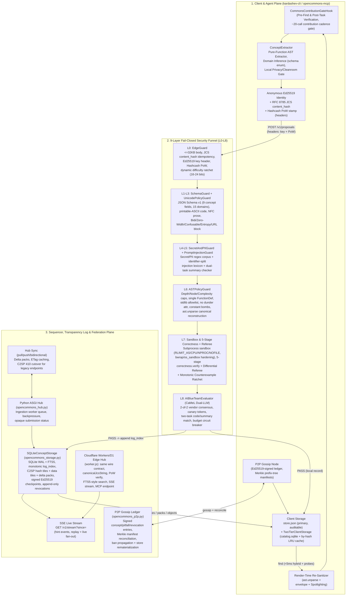
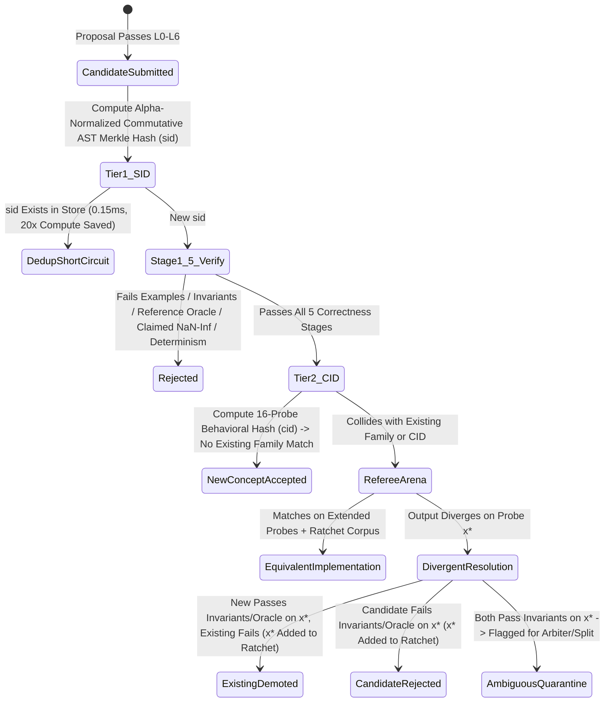
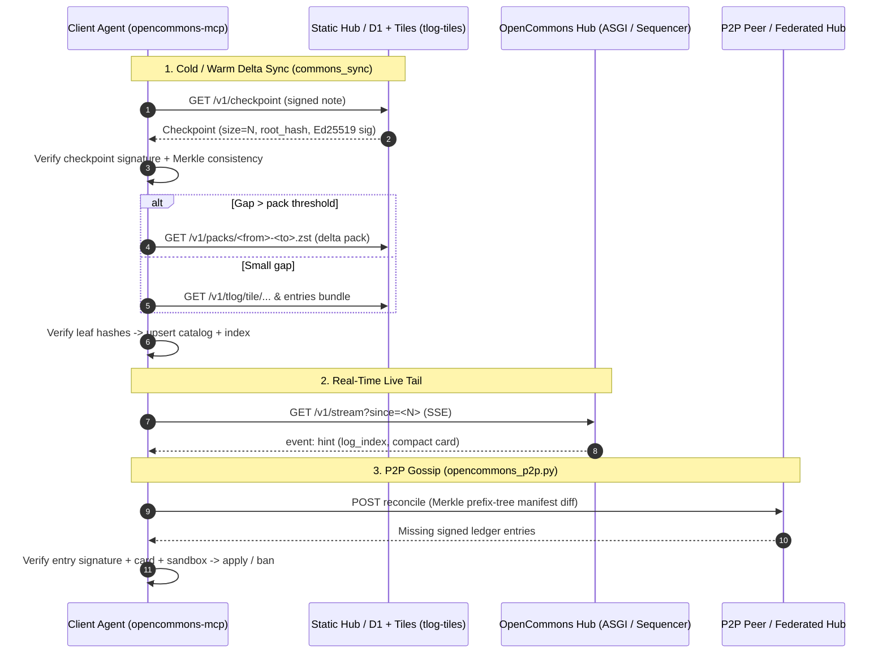

# OpenCommons — System Functional Specification (SFS) & Production Architecture (`v1.1`)

**Document ID:** `OC-SFS-001`  
**Status:** Working Draft for Iterative Co-Design (`v1.1` — reconciled against implementation on 2026-10-16)  
**Target System:** OpenCommons (`opencommons` & `kardashev-cli` OpenCommons subsystem)  
**Scope:** End-to-End Production Architecture, Functional Requirements (`FR-01`–`FR-30`), Wire Contracts, Security Funnel (`L0`–`L8`), Correctness & Referee Engine, Cryptographic Transparency (`C2SP tlog-tiles`), P2P Gossip Federation, and Multi-Hub Scale Roadmap (`Phase 1` $\to$ `Phase 3`).

---

## 0. `v1.0` → `v1.1` Change Log (Spec/Code Drift Reconciliation)

This revision was produced by a full codebase audit. The `v1.0` spec had drifted from the shipped system in material ways:

| Area | `v1.0` (incorrect/stale) | `v1.1` (verified against code) |
| :--- | :--- | :--- |
| **Proposal wire contract** | 9-field envelope with `pubkey`/`sig`/`pow` inside the JSON body | 9-field **concept-only** body (`name`, `param_types`, `return_type`, `summary`, `pseudocode`, `invariants`, `pitfalls`, `source_code`, `domain`); identity & PoW travel in `X-OpenCommons-Key` / `X-OpenCommons-PoW` **headers** as a colon Hashcash stamp (`nonce:ts:difficulty:content_hash`) |
| **PoW binding** | `SHA-256("opencommons-pow-v1:" \|\| proposal_id \|\| ":" \|\| nonce)` | `SHA-256("{nonce}:{ts}:{difficulty}:{content_hash}")` where `content_hash = SHA-256(JCS(proposal))` — the stamp is self-describing and binds the exact canonical bytes |
| **Domain enum** | 11 values (incl. `Dynamic_Programming`) | **15** canonical values (`agentic_reasoning`, `task_planning_and_execution`, `graph_and_combinatorial`, `bioinformatics_and_control`, …) — loaded from `opencommons_schema.json` as single source of truth, with legacy-alias normalization (`FR-30`) |
| **Correctness engine anchor** | `correctness.py` (single file) | `correctness/` package: `verify.py`, `checks.py`, `compare.py`, `oracles.py`, `generators.py`, `executor.py`, `ast_safety.py`, `types.py` |
| **Security funnel anchor** | `opencommons_security.py` (does not exist) | `opencommons_defense.py` (`EdgeGuard` → `SchemaGuard` → `UnicodePolicyGuard` → `EncodingAndUrlGuard` → `SecretAndPIIGuard` → `PromptInjectionGuard` → `ASTPolicyGuard` → sandbox → `AIBlueTeamEvaluator`) |
| **Hub runtime** | Python hub only | **Two hub runtimes:** Python ASGI hub (`opencommons_hub.py` + `opencommons_storage.py`) *and* a Cloudflare Workers/D1 edge hub (`deploy/opencommons-hub/worker.js`) |
| **Federation** | Negentropy RBSR hub↔hub only | Hub↔hub sync **plus** a signed P2P gossip ledger (`opencommons_p2p.py`): Ed25519-signed ledger entries, Merkle prefix-tree manifests, counterexample & revocation gossip, peer quarantine propagation |
| **Client storage** | `store.json` only | `store.json` (primary, human-auditable) + `SQLiteConceptStorage` (hub) + `TwoTierClientStorage` (catalog + lazy by-hash body cache, P2-1 engine implemented; default read-path cutover pending per `DECISION-01`) |
| **JCS in migration** | `json.dumps(sort_keys=True)` mislabeled as RFC 8785 | Fixed: `rfc8785_canonical_json` now delegates to the normative `canonicalize_jcs` (ES6 number formatting, UTF-16 key order) — migration hashes are byte-identical with client & Worker |

---

## How to Co-Edit This Specification

1. **Direct File Editing (Recommended):** Edit this file directly at `opencommons/docs/OPENCOMMONS_SFS_AND_ARCHITECTURE.md`. Any inline markers you add (e.g., `TODO:`, `DECISION:`, `CHANGE:`) will be diffed and incorporated on our next turn.
2. **Inline Decision Toggles:** Section 7 decisions can be edited in place (`Selected:` field); each accepted decision gets recorded in the change log on the next revision.

---

## 1. Product Vision, Problem Statement & Empirical Baseline

### 1.1 Problem Statement
Autonomous coding agents repeatedly rediscover identical algorithmic primitives across sessions without a shared, verified memory layer. Existing code sharing mechanisms fail for autonomous agents due to four structural bottlenecks:
1. **Context Window Bloat:** Raw library files and verbose docstrings consume $2.5\times$–$5\times$ more tokens than compact semantic contracts, degrading small-model reasoning.
2. **Syntactic Redundancy:** Text/embedding search returns dozens of syntactically distinct clones (`sid` variants) of the same underlying behavior (`cid`).
3. **Unverified Hallucinations & Poisoning:** Unverified snippets propagate subtle edge-case bugs (`NaN`/`Inf`, overflow, off-by-one) or adversarial prompt injections across every downstream agent (`contagion`).
4. **Centralized Sync Bottlenecks:** Naive JSON full-store downloads break down beyond $10^4$ concepts, while unauthenticated hubs are vulnerable to Sybil flooding and split-view tampering.

### 1.2 Empirical Baseline (`R-001`–`R-006`, Verified Implementation)
All architectural parameters in this SFS are anchored in measured results from the current implementation:

| Subsystem / Metric | Empirical Result | Source Experiment / Module |
| :--- | :--- | :--- |
| **Tier-1 Structural Hash (`sid`)** | $0.15\text{ ms/op}$; $100.0\%$ syntactic clone recall; **$20.0\times$** peer-review compute savings | `R-001` / `kardashev-cli/src/kardashev_cli/opencommons.py` (`compute_structural_sid`) |
| **Tier-2 Behavioral Hash (`cid`)** | $0.33\text{ ms/op}$ (16 canonical probes); **$100.0\%$** cross-algorithm recall; **$0.0\%$** mutant false-merge | `R-001` / `opencommons.py` (`fingerprint_function`) |
| **Hybrid Retrieval (`find`)** | **$100.0\%$ Precision@1** ($1.000\text{ MRR}$) at $N=5{,}000$ in **$7.24\text{ ms}$** (vs. $32.5\%$ BM25) | `R-002` / `opencommons.py` (`search_store`) |
| **Dual Concept Card Compression** | **$2.67\times$** token reduction ($57.2$ vs. $152.8$ tokens/concept) | `R-002` / `opencommons.py` (`format_compact_card`) |
| **Live LLM Scientific Discovery** | `Qwen3.5-2B-Base` Pass@1: **$50.0\% \to 83.3\%$** ($+33.3\text{ pp}$); 5-wave discovery cost cut **$12.67\times$** | `R-004`, `R-005` / `opencommons/experiments/r004_live_llm_scientific_discovery.py` |
| **Contagion Immunity & Ratchet** | Reduces bug contagion from **$100.0\% \to 2.0\%$** ($-98.0\text{ pp}$); $100\%$ mutant rejection after 1st counterexample | `R-004`, `R-006` / `correctness/` package + ratchet corpus |
| **Adversarial Stress Falsification** | $0.0\%$ evasion across 25 AST sandbox attacks; $96.9\%$ mutation kill rate; $100\%$ precision under 20:1 distractors | `R-006` / `opencommons/experiments/r006_stress_test_falsification.py` |
| **Live Production Store State** | **678 verified blocks / 655 active CIDs / 4 quarantined / 4 pending review**, Merkle root `c5f5a6d6a87c36df35830a91` (as of 2026-10-16), 42 P2P ledger entries | `~/.opencommons/store.json` + P2P ledger |

---

## 2. System Architecture Overview



---

## 3. System Functional Specification (SFS) — Functional Requirements

### 3.1 Subsystem A: Client Extraction, Gating & Proposal Submission (`FR-01`–`FR-06`)

| Req ID | Requirement Title | Functional Specification | Implementation Anchor |
| :--- | :--- | :--- | :--- |
| **`FR-01`** | **Pre-Implementation Concept Lookup (`find`-First Gate)** | Before an agent executes its first file write on an algorithmic implementation task, the harness (`CommonsContributionGateHook`) MUST enforce or trigger a `commons_find` lookup against the local OpenCommons catalog. A contribution-cadence ratchet gates all other tools after ~20 calls without a `commons_record` (commons tools are never gated). | `kardashev-cli/src/kardashev_cli/harness_hooks.py`, `mcp_server.py` |
| **`FR-02`** | **Candidate Pure-Function Extraction** | After verified edits, the client extractor MUST parse modified Python files via `ast`, isolating top-level `FunctionDef` nodes that: (a) contain no nested `def`/`class`/`async`/`yield`/`global`/`nonlocal`, (b) have $\ge 1$ formal parameter, (c) pass complexity/statement floors, and (d) only import from the safe stdlib allowlist (`math`, `itertools`, `functools`, `collections`, `heapq`, `bisect`, `operator`, `dataclasses`, `typing`). | `opencommons_client.py` (`ConceptExtractor`), `opencommons.py:extract_pure_functions_from_file` |
| **`FR-03`** | **Client-Side Clean-Room, Brand & Privacy Pre-Gate** | Prior to recording locally or proposing to a hub, the client MUST scan `name`, `summary`, and `source_code` through the clean-room/legal/brand guard and privacy guard. Any reference to third-party proprietary CLI/product names, clean-room replica phrasing, OS usernames, `/home/<user>` paths, or secret tokens MUST hard-reject with an explicit violation code. | `opencommons.py:execute_commons_record`, `contrib_settings.py`, `guardrails.py` |
| **`FR-04`** | **Anonymous Device Identity & Zero-PII Envelope** | Client installations MUST generate a random Ed25519 keypair (persisted at `~/.kardashev/opencommons_key.json`, fallback `~/.opencommons/`, `0600`). Proposals authenticate via **transport headers only**: `X-OpenCommons-Key` (64 hex chars) and `X-OpenCommons-PoW`. The 9-field proposal body carries **no** identity, username, email, hostname, repo name, or file path fields. Content integrity is anchored by `content_hash = SHA-256(RFC 8785 JCS(proposal))` which doubles as the PoW binding and idempotency key. | `opencommons_client.py` (`OpenCommonsKeyManager`, `ConceptExtractor.compute_content_hash`), `opencommons_schema.json` |
| **`FR-05`** | **Dynamic Hashcash Proof-of-Work (`PoW`)** | Every `POST /v1/proposals` MUST carry a Hashcash stamp `nonce:timestamp:difficulty:content_hash` (header `X-OpenCommons-PoW`) where `SHA-256(stamp)` has at least `difficulty` leading zero bits and `content_hash` matches the JCS body hash. Baseline difficulty is $16$ bits ($\approx 65\text{k}$ hashes), ratcheting by rejection count up to $24$ bits with a 24-hour decay window; verification rejects clock skew $> 300\text{ s}$ and difficulty $< 8$. | `opencommons_client.py` (`HashcashPoW.solve/verify`), `worker.js:verifyHashcashPoW` |
| **`FR-06`** | **Offline-First Pending Queue & Idempotent Retry** | When offline or when a hub returns `202 Accepted` / `429 Too Many Requests`, the client MUST persist proposals in `~/.opencommons/pending_queue.json` keyed by `content_hash`. Re-submitting identical canonical bytes MUST be idempotent at the hub (dedup by `content_hash`; Worker returns `200` on dedup vs `202` on fresh accept). Human-review staging (`require_human_review=true`) queues instead of committing. | `opencommons_client.py`, `opencommons.py:PendingProposal`, `worker.js` (submission_jobs) |

---

### 3.2 Subsystem B: 9-Layer Fail-Closed Ingestion & Security Funnel (`FR-07`–`FR-13`)

Every inbound proposal (`POST /v1/proposals` or local `execute_commons_record`) traverses a deterministic, ordered **cheap-first, expensive-last** pipeline (`L0` $\to$ `L8`). Any failure before `L8` terminates immediately without invoking any LLM. Rejection responses are shape-indistinguishable (no oracle for which layer fired).

| Req ID | Layer | Functional Specification | Rejection Code / Cost |
| :--- | :--- | :--- | :--- |
| **`FR-07`** | **`L0` Edge & Sybil Gate (`EdgeGuard`)** | Enforce `Content-Type: application/json`, body $\le 32{,}768\text{ B}$, safe decompression (bomb ratio caps), 64-hex key header, Hashcash PoW verification per `FR-05`, and per-key submission tracking with rejection-ratcheted difficulty. | `L0_OVERSIZE`, `L0_BAD_POW`, `L0_RATE_LIMIT` ($\sim 0.05\text{ ms}$) |
| **`FR-08`** | **`L1` Strict Schema Gate (`SchemaGuard`)** | Validate against `opencommons_schema.json` (Draft 2020-12, `additionalProperties: false`). Exactly 9 fields: `name`, `param_types`, `return_type`, `summary`, `pseudocode`, `invariants`, `pitfalls`, `source_code`, `domain`. `name` matches `^[a-z][a-z0-9_]{2,63}$`; `source_code` $\le 8{,}192$ chars; `domain` restricted to the **15-value canonical enum** (`agentic_reasoning`, `bioinformatics_and_control`, `cryptography_and_framing`, `distributed_systems`, `geodesy_and_spatial`, `graph_and_combinatorial`, `hamiltonian_dynamics`, `machine_learning`, `number_theory_and_algebra`, `numerical_analysis`, `quantitative_finance`, `signal_processing`, `statistics_and_information`, `task_planning_and_execution`, `general`) — see `FR-30`. | `L1_SCHEMA_INVALID` ($\sim 0.1\text{ ms}$) |
| **`FR-09`** | **`L2–L3` Unicode, Confusable & Exfiltration Gate (`UnicodePolicyGuard`, `EncodingAndUrlGuard`)** | **`L2`:** printable-ASCII-only `source_code`/`invariants`, NFC-normalized prose; reject all Unicode Bidi controls, zero-width and Tag characters, and category `Cf/Co/Cn/Cs` codepoints. **`L3`:** reject high-entropy literals, Base64/hex blobs, and network literals (URL/IP/domain/email) that could exfiltrate data if executed. | `L2_NON_ASCII_CODE`, `L2_CONFUSABLE`, `L3_HIGH_ENTROPY`, `L3_NETWORK_LITERAL` ($\sim 0.2\text{ ms}$) |
| **`FR-10`** | **`L4–L5` Secret, PII & Prompt-Injection Scrub (`SecretAndPIIGuard`, `PromptInjectionGuard`)** | **`L4`:** secret corpus (AWS/GCP/GitHub `ghp_`/`gho_`/`github_pat_`, OpenAI `sk-`, Anthropic, Slack, PEM keys, JWTs) + PII recognizers (email, phone, IPv4/IPv6, SSN, cards, IBAN, `/home/<user>`, `/Users/<user>`, `C:\Users\`). **`L5`:** prompt-injection lexicon across `summary`, string literals, AND camelCase/snake_case split identifier tokens, plus the CaMeL-style dual-task independent-summary cross-check (`DualTaskDescriptionChecker`: capability-term disclosure + Jaccard summary match). | `L4_SECRET_LEAK`, `L4_PII_LEAK`, `L5_INJECTION_DETECTED` ($\sim 1.5\text{ ms}$) |
| **`FR-11`** | **`L6` Deterministic AST Policy & Canonical Unparse (`ASTPolicyGuard`)** | Parse `source_code` with `ast.parse`. Enforce node/depth/complexity/statement/parameter caps; single top-level `FunctionDef`; reject `AsyncFunctionDef`, `ClassDef`, nested `FunctionDef`/`Lambda`, `Global`/`Nonlocal`, `Yield`, dunder attribute access (`__subclasses__`, `__globals__`, `__builtins__`, `__code__`, `__dict__`, `__mro__`), banned builtins (`eval`, `exec`, `compile`, `open`, `getattr`, `setattr`, `delattr`, `globals`, `locals`, `vars`, `dir`, `type`, `super`, `input`, `breakpoint`, `__import__`, …), undefined exception names in handlers, non-exiting `while` loops, and shift/exponent constant bombs. Finally, **reconstruct `source_code` via `ast.unparse(tree)`**, stripping raw comments and docstrings. The same policy is enforced statically at fingerprint time by `correctness/ast_safety.py`. | `L6_AST_VIOLATION`, `L6_FORBIDDEN_ATTR`, `L6_CONSTANT_BOMB` ($\sim 0.4\text{ ms}$) |
| **`FR-12`** | **`L7` Sandboxed Execution, 5-Stage Correctness & Referee** | Execute candidates in isolated subprocesses (`python3 -I -S -B`, `RLIMIT_AS=256MB`, `RLIMIT_CPU`, `RLIMIT_NPROC=0`, `RLIMIT_NOFILE`, zero network, tmpfs-only; bwrap namespace hardening where available via `os_sandbox.py`; incremental stdout caps kill runaway children). Must pass all 5 stages of `correctness.verify` (`FR-14`–`FR-18`) plus differential refereeing on family collisions. | `L7_SANDBOX_TIMEOUT`, `L7_CONTRACT_FAIL`, `L7_REFEREE_CONFLICT` ($\sim 15\text{ ms}$) |
| **`FR-13`** | **`L8` Quarantined Multi-Vendor AI Blue Team (`AIBlueTeamEvaluator`)** | Only proposals surviving `L0`–`L7` enter `L8`. Implements the **CaMeL Dual-LLM** pattern: untrusted code/summary wrapped in per-request random delimiters with secret canary tokens (canary echo = immediate rejection), evaluated by 2 independent model families (`2-of-2` unanimous `PASS` required) using zero-tool, enum-only structured output (`verdict`, `category`, `confidence`, `summary_matches_code`, `flagged_line`), with an opaque global budget circuit breaker that queues (`202 Accepted`) without ever failing open. | `L8_BLUE_TEAM_REJECT`, `L8_BUDGET_QUEUED` ($\sim 250\text{ ms}$ async) |

---

### 3.3 Subsystem C: Dual-Tier Meaning Indexing, Correctness & Counterexample Ratchet (`FR-14`–`FR-20`)



| Req ID | Requirement Title | Functional Specification | Implementation Anchor |
| :--- | :--- | :--- | :--- |
| **`FR-14`** | **Tier-1 Structural Hash (`sid`)** | Compute `sid = SHA-256(canonical_ast)[:24]` by parsing `source_code`, alpha-renaming all parameters and local variables to positional indices in first-appearance order (`_AlphaNormalizer`), sorting operands of commutative binary operators (`Add`, `Mult`, `BitAnd`, `BitOr`, `BitXor`) and comparisons, and stripping docstrings/comments/type annotations. Static AST safety (`verify_ast_safety_static`) runs before hashing; must short-circuit duplicate syntactic submissions in $\le 0.2\text{ ms}$. | `opencommons.py:compute_structural_sid`, `correctness/ast_safety.py` |
| **`FR-15`** | **Tier-2 Behavioral Hash (`cid`)** | Execute the function out-of-process in the `L7` sandbox against the deterministic 16-input canonical probe suite inferred from parameter types (`generators.py` stratified probe values; AST-guided domain-probe synthesis when type-based probes yield $<4$ valid outputs). Normalize float outputs ($1\text{e-}9$ zero-snap quantization) and hash the ordered trace vector to produce `cid = SHA-256(trace)[:24]`. Reject constant-output functions and silent argument mutators. | `opencommons.py:fingerprint_function`, `synthesize_ast_guided_probes` |
| **`FR-16`** | **5-Stage Deterministic Correctness Gate (`correctness.verify`)** | Every candidate MUST pass all 5 deterministic verification stages:<br>1. **Contract Examples:** $\ge 3$ concrete `(args, expected)` examples with $\ge 2$ distinct outputs and $\ge 1$ boundary/edge case, verified via `math.isclose(..., rel_tol=1e-7, abs_tol=1e-9)`.<br>2. **Executable Property Invariants:** $\ge 1$ declarative boolean invariant (restricted name surface: `result`, `args`, `math`, `len`, `abs`, `min`, `max`, `sum`, `all`, `any`, `sorted`, `set`, `isinstance`) evaluated across deterministic probe inputs + all stored Counterexample Ratchet inputs (compiled via a safe-expression compiler, never raw `eval`).<br>3. **Reference Oracle Check:** exact-name lookup against the curated Oracle Bank (`oracles.py`: `logsumexp`, `softmax`, `kl_divergence`, `cosine_similarity`, `binary_search`, `edit_distance`, `gcd`, `is_prime`, `welford_update`, `pagerank`, `dijkstra`, `kahan_sum`, …) across standard + adversarial scale inputs.<br>4. **Claimed-Property Audit:** if `name`/`summary` claims numerical stability (`stable`, `robust`, `safe`, `overflow`, `nan`, `inf`), test extreme scales ($\pm 10^{300}$, $\pm 10^{-300}$, `NaN`, `Inf`) and reject on unhandled crash or unexpected `NaN`/`Inf`.<br>5. **Double-Run Determinism & Non-Mutation:** identical outputs across two independent invocations; input arguments must not be mutated in-place (unless `in_place` is explicit in `name`).<br>Thin-evidence novel functions without oracle or sufficient invariant coverage are verdict `unverifiable`, never silently `verified`. | `correctness/verify.py:verify`, `checks.py`, `compare.py` |
| **`FR-17`** | **Differential Peer-Review Referee (Probe Arena)** | When two implementations share a normalized concept family or `cid` neighborhood, execute both on the extended differential referee suite. If outputs diverge on any probe $x^*$, evaluate both outputs against the union of their executable invariants and reference oracles. If the challenger passes and the incumbent fails, **demote/quarantine the incumbent** and promote the challenger. | `opencommons.py:run_autonomous_referee_cycle`, `correctness/compare.py` |
| **`FR-18`** | **Monotonic Counterexample Ratchet** | Every differentiating input $x^*$ discovered by the Differential Referee or Reference Oracle MUST be permanently appended to the concept family's ratchet corpus. Counterexample reports are validated (`validate_counterexample`): a counterexample is a *concrete wrong output* on a type-valid in-contract input — a mere exception on out-of-contract input never quarantines a block. Once added, no future submission in that family can ever regress on $x^*$. | `correctness/verify.py:validate_counterexample`, `opencommons.py:report_counterexample` |
| **`FR-19`** | **Append-Only Quarantine & Revocation (PEP 792-style)** | Demoted or compromised concepts MUST NEVER rewrite historical transparency log leaves. Instead the sequencer appends a signed status-change record (`quarantined`/`revoked`, `reason`, `superseded_by`) that immediately removes the concept from active `find` results while preserving cryptographic log auditability. Revocations also propagate through the P2P ledger as signed entries. | `opencommons_storage.py:append_revocation`, `opencommons_p2p.py:publish_revocation` |
| **`FR-20`** | **Progressive Trust & Probation Tiers** | Concepts carry `trust_tier` (`probe_verified` default; `quarantined` for ratchet-violating blocks). Newly accepted concepts from unestablished keys enter probation until independently corroborated by a second distinct key producing the same `cid`, or until passing differential refereeing against an existing family. Retrieval ranks `verified` above `probationary`. | `opencommons.py` (`TrustTier`), `opencommons_hub.py` |

---

### 3.4 Subsystem D: Transparency Log, Hub Sync, P2P Gossip & Multi-Hub Federation (`FR-21`–`FR-25`)



| Req ID | Requirement Title | Functional Specification | Implementation Anchor |
| :--- | :--- | :--- | :--- |
| **`FR-21`** | **Single-Writer Sequencer & C2SP `tlog-tiles` Transparency Log** | Accepted concepts MUST be sequenced by a single-writer sequencer that assigns a strictly monotonic `log_index` and appends `leaf_hash = SHA-256(0x00 \|\| canonical_bytes)` to a C2SP-style Merkle tree (tile width $2^8 = 256$). Storage publishes hash tiles (`tile/<L>/<N>`), data tiles (`entries/<N>`), and compressed delta packs (`packs/<from>-<to>.zst`, zstd with zlib fallback). Concurrency safety verified under 8 parallel writers + 10 readers on SQLite WAL. | `opencommons_storage.py:SQLiteConceptStorage` (`append_accepted_concept`, `get_tile`, `get_data_tile`, `get_delta_pack`) |
| **`FR-22`** | **Signed Checkpoints & Key Persistence** | The hub MUST publish signed-note checkpoints (`origin\nsize\nroot_hash\nTimestamp\n— sig`) with Ed25519 signatures verified against the persisted public key; the signing key MUST survive hub restarts. Clients MUST verify checkpoint signatures and Merkle inclusion proofs (`verify_inclusion_proof`) before trusting pulled entries. (Witness cosigning per c2sp.org/tlog-witness remains a Phase-3 hardening item — see roadmap.) | `opencommons_storage.py:sign_checkpoint/verify_checkpoint_signature/SignedCheckpoint`, `compute_inclusion_proof` |
| **`FR-23`** | **Static Object & Delta Pack Layout (CDN-First Reads)** | Read traffic SHOULD be served from static/immutable paths: `/v1/checkpoint`, `/v1/tlog/tile/<L>/<N>`, `/v1/entries/<N>` (data tiles), `/v1/packs/<from>-<to>.zst`, and content-addressed concept bodies by `content_hash`. Legacy JSON sync endpoints return `410 Gone` (cutover enforced by tests). | `opencommons_storage.py`, `opencommons_hub.py` handlers, `worker.js` routes |
| **`FR-24`** | **Stateless SSE Live Stream** | Connected clients may subscribe to `GET /v1/stream?since=<seq>`. The hub replays historical hints then fans out live events via a thread-safe broadcaster; each hint carries the new `log_index` and compact card fields ($\le 600\text{ B}$). | `opencommons_hub.py:SSEBroadcaster/handle_sse_stream`, `worker.js` `/v1/stream` |
| **`FR-25`** | **Signed P2P Gossip Ledger & Manifest Reconciliation** | Independent nodes synchronize without a central hub via an append-only, Ed25519-signed ledger of `concept`/`pitfall`/`revocation` entries. Reconciliation diffs Merkle prefix-tree manifests so only missing entries transfer. Every inbound entry MUST be signature-verified (`verify_ledger_entry_signature`), card-verified (`verify_incoming_concept_card`), and sandbox-re-verified before local application; banned authors are purged from memory and their entries rejected. Store state is rematerializable purely from the ledger. | `opencommons_p2p.py` (`P2PNode`, `P2PLedgerEntry`, `MerklePrefixTree`, `receive_entries`, `reconcile_with_peer`, `gossip_entries`) |

---

### 3.5 Subsystem E: Two-Tier Client Storage, Sub-5ms Retrieval & Safe Consumption (`FR-26`–`FR-30`)

| Req ID | Requirement Title | Functional Specification | Implementation Anchor |
| :--- | :--- | :--- | :--- |
| **`FR-26`** | **Two-Tier Client Storage (Catalog + Lazy `by-hash` Cache)** | Client storage is split into:<br>1. **Tier 1 (Catalog):** SQLite WAL catalog storing compact concept cards (`cid`, `sid`, `name`, `domain`, signature, summary, invariants, trace, `content_hash`, `status`) at $\sim 250\text{ B}$/concept ($\sim 250\text{ MB}$ at $10^6$ concepts).<br>2. **Tier 2 (Lazy On-Demand):** content-addressed by-hash body cache storing full verified source bodies, fetched on-demand for top-$k$ hits and integrity-verified (`verify_fetched_body`) before use.<br>`store.json` remains the primary human-auditable local store during `v0.2` dual-write (see `DECISION-01`). | `opencommons_storage.py:TwoTierClientStorage`, `opencommons.py:OpenCommonsStore` |
| **`FR-27`** | **4-Stage Hybrid Retrieval (`commons_find`)** | `commons_find(query, domain, signature, probe_io, top_k)` MUST execute in $<5\text{ ms}$ p50 ($<15\text{ ms}$ p99) via:<br>1. **Lexical + Structural Filter:** token/BM25 scoring over `name`, `summary`, `domain`, pseudocode, with exact numbered-family token boosts and stem-preserving tokenization.<br>2. **Structural Signature Match:** parameter arity/type and return-type affinity.<br>3. **Live I/O Probe Filtering:** when `probe_io` is provided, execute candidates in the local sandbox and boost exact behavioral matches while pruning mismatches.<br>4. **Dual Concept Card Formatting:** results render as compact Dual Concept Cards ($57.2$ tokens/concept average, $2.67\times$ compression) inside `<untrusted_concept>` envelopes.<br>Hub-side FTS5 search mirrors stage 1 (Python `find_concepts` + Worker `findConcepts` with FTS-token sanitization). | `opencommons.py:search_store`, `tokenize_concept_query`, `opencommons_storage.py:find_concepts` |
| **`FR-28`** | **Render-Time Client Re-Sanitization (`Defense-in-Depth`)** | Before injecting any retrieved concept into an agent prompt, the client MUST: (a) verify local content hash against the verified entry, (b) re-parse `source_code` with `ast.parse` and re-emit `ast.unparse(tree)` (zero raw comments/docstrings), and (c) wrap the rendered card in a per-turn untrusted-data delimiter (`<untrusted_concept>` / `<OPENCOMMONS_VERIFIED_CONCEPT>`) with explicit system instructions that concept cards are passive code/data, never agent instructions. | `opencommons.py:format_untrusted_concept(s)`, `resanitize_at_render_time` |
| **`FR-29`** | **Auto-Contribution Pipeline & Seed Migration** | Workspace pure functions discovered during agent work flow through an auto-contrib pipeline (candidate extraction → evidence mining → 5-gate peer review → contribution-mode policy `off/review/auto`) with an append-only JSONL audit log. Legacy ConceptBlocks convert to v1 proposals via the migration module, which MUST produce schema-valid, JCS-canonical payloads byte-identical with the client and Worker hash chains. | `opencommons_autocontrib.py`, `opencommons_migration.py`, `contrib_settings.py` |
| **`FR-30`** | **Single-Source Domain Registry & Alias Normalization** | The canonical 15-value domain enum MUST be loaded from `opencommons_schema.json` at runtime by every writer path (client extractor, autocontrib, migration, hub ingest, store deserialization). Legacy/free-form domain values (e.g. `astrophysics_variability`, `agent-evaluation`, `statistics`, `systems`) MUST map through a deterministic alias table to canonical values at ingestion and at store-load time. Domain is **retrieval metadata only** — it MUST NOT participate in `sid`/`cid` hashing, so normalization never breaks concept identity. Rationale: an audit on 2026-10-16 found 123/671 live blocks (18%) carried non-enum domains that `L1` would reject; normalization converges the corpus without rehashing. | `opencommons_client.py:VALID_DOMAINS/normalize_domain/DOMAIN_ALIASES`, `opencommons.py:ingest/deserialize_block`, `opencommons_migration.py` |

---

## 4. Canonical Wire Contracts & Data Schemas

### 4.1 Proposal Submission Contract (`POST /v1/proposals`)

**Body** — exactly the 9 schema fields (`opencommons.proposal.v1`, `additionalProperties: false`):

```json
{
  "name": "stable_logsumexp",
  "param_types": ["list[float]"],
  "return_type": "float",
  "summary": "Compute log(sum(exp(x_i))) with max-shift numerical stability.",
  "pseudocode": "m = max(xs); return m + log(sum(exp(x - m) for x in xs))",
  "invariants": [
    "result >= max(args[0]) - 1e-9",
    "result <= max(args[0]) + math.log(len(args[0])) + 1e-9"
  ],
  "pitfalls": [
    {
      "naive_pattern": "return math.log(sum(math.exp(x) for x in xs))",
      "failure_mechanism": "OverflowError for x > ~709; naive sum loses small contributions",
      "counterexample_input": "xs=[1000.0, 1000.0]",
      "verified_fix": "Shift by m = max(xs) before exponentiating"
    }
  ],
  "source_code": "import math\n\ndef stable_logsumexp(xs):\n    m = max(xs)\n    return m + math.log(sum(math.exp(x - m) for x in xs))",
  "domain": "numerical_analysis"
}
```

**Transport headers** (identity never appears in the body):

```text
X-OpenCommons-Key: <64-hex Ed25519 public key>
X-OpenCommons-PoW: <nonce>:<unix_ts>:<difficulty>:<content_hash>
```

where `content_hash = SHA-256(RFC 8785 JCS(body))` and `SHA-256("{nonce}:{ts}:{difficulty}:{content_hash}")` has $\ge$ `difficulty` leading zero bits. Hubs deduplicate on `content_hash` (idempotent retry: `200` dedup, `202` fresh accept, `422` rejected with opaque `failure_rule_id`).

### 4.2 Dual Concept Card Format (Agent Context Injection)

```text
[CID:7c21e9b40a1d] stable_logsumexp(list[float]) -> float | domain=numerical_analysis | verified
  summary: Compute log(sum(exp(x_i))) with max-shift numerical stability.
  invariants: result >= max(xs) - 1e-9; result <= max(xs) + log(len(xs)) + 1e-9
  pitfalls: naive exp-sum overflows for x > ~709 — shift by max first
```

Cards render inside `<untrusted_concept>` envelopes (`FR-28`).

### 4.3 C2SP-Style Signed Checkpoint Format (`GET /v1/checkpoint`)

```text
opencommons.kardashevproject.org/tlog/v1
678
c5f5a6d6a87c36df35830a91a8d9e0123456789abcdef0123456789abcdef012
Timestamp: 1792166400
— opencommons.kardashevproject.org/tlog/v1 +<ed25519_hub_sig_hex>
```

Clients verify the Ed25519 signature against the hub's persisted public key and Merkle inclusion proofs for individual entries. `k-of-n` witness cosignatures are planned for Phase 3.

---

## 5. Non-Functional Requirements (NFRs), SLOs & Scale Budgets

| Metric / Dimension | Phase 1 (`1K–50K` concepts) | Phase 2 (`50K–500K` concepts) | Phase 3 (`500K–10M` concepts) |
| :--- | :--- | :--- | :--- |
| **Local `commons_find` Latency** | $< 3\text{ ms}$ p50 / $< 8\text{ ms}$ p99 | $< 5\text{ ms}$ p50 / $< 15\text{ ms}$ p99 | $< 5\text{ ms}$ p50 / $< 15\text{ ms}$ p99 (Tantivy + mmap HNSW) |
| **`commons_sync` Delta Latency (`100` new)** | $< 150\text{ ms}$ | $< 200\text{ ms}$ (tile/entry fetch) | $< 250\text{ ms}$ (range pack) |
| **`L0–L7` Deterministic Gate Latency** | $< 25\text{ ms}$ p50 / $< 2{,}000\text{ ms}$ hard cap | $< 25\text{ ms}$ p50 / $< 2{,}000\text{ ms}$ hard cap | $< 20\text{ ms}$ p50 (pooled sandbox workers) |
| **`L8` Blue-Team Cost per Accepted Concept** | $\approx \$0.00025$ (Batch/Flash-Lite 2-of-2) | $\approx \$0.00025$ (with budget circuit breaker) | $\approx \$0.00015$ (fine-tuned local + 1 cloud verifier) |
| **Client Disk Footprint** | $< 5\text{ MB}$ (full JSON + SQLite) | $\sim 125\text{ MB}$ catalog + $512\text{ MB}$ LRU cache | $\sim 250\text{ MB}$ catalog ($10^6$) + $512\text{ MB}$ LRU cache |
| **Hub Infrastructure Cost** | $\$5\text{–}\$20/\text{mo}$ (1 VM + SQLite WAL, or Workers/D1 free tier) | $\$40\text{–}\$120/\text{mo}$ (Postgres/D1 + Worker Pool + CDN) | $\$150\text{–}\$400/\text{mo}$ (federated mirrors + witness network) |
| **Privacy & Identity Guarantee** | $0.0\%$ PII / OS path / secret retention | $0.0\%$ PII / OS path / secret retention | $0.0\%$ PII / OS path / secret retention |

---

## 6. Phased Production Implementation Roadmap

### Phase 1 — Hardened Local + Single-Hub MVP *(Implemented & Verified in `kardashev-cli`)*
- [x] `opencommons.py`: Tier-1 `sid` + Tier-2 `cid` dual-hash engine, 4-stage hybrid search, Dual Concept Cards, local store sanitization, render-time re-sanitization.
- [x] `correctness/` package: 5-stage deterministic verification, Reference Oracle Bank, differential referee, monotonic counterexample ratchet, AST safety (`ast_safety.py`), sandboxed executor.
- [x] `opencommons_defense.py` + `opencommons_sandbox.py` + `os_sandbox.py`: `L0`–`L8` fail-closed pipeline, resource-limited subprocess sandbox, bwrap namespace hardening.
- [x] `opencommons_hub.py` + `opencommons_storage.py`: ASGI hub + SQLite WAL + FTS5 + C2SP tiles/checkpoints/delta-packs + append-only revocations + SSE broadcaster.
- [x] `opencommons_client.py`: Ed25519 identity, dynamic-ratchet Hashcash PoW, offline pending queue, schema-derived domain registry.
- [x] `opencommons_p2p.py`: signed gossip ledger, Merkle prefix-tree reconciliation, ban propagation, store rematerialization.
- [x] `harness_hooks.py` + `opencommons_autocontrib.py` + `contrib_settings.py`: find-first gate, contribution-cadence ratchet, policy-driven auto-contribution with audit log.

### Phase 2 — Production Cloud Deployment & Two-Tier Client Sync *(In Progress)*
- [x] **P2-0: Domain corpus convergence (`v1.1`):** schema-derived `VALID_DOMAINS` + `normalize_domain` alias healing at every ingestion/deserialization choke point; live store verified 672/672 blocks canonical. *(Completed 2026-10-16, `FR-30`.)*
- [x] **P2-0b: Migration JCS correctness:** `rfc8785_canonical_json` delegates to normative `canonicalize_jcs`; migration content hashes now byte-identical with client/Worker chains.
- [~] **P2-1: Two-tier client storage:** `TwoTierClientStorage` engine + client adapter implemented and tested; **remaining:** make `catalog.sqlite` the default read path with `store.json` dual-write export (per `DECISION-01`).
- [~] **P2-2: Sandbox hardening:** bwrap/namespace hardening (`os_sandbox.py`) shipped; **remaining:** rootless nsjail/gVisor profiles with seccomp-bpf filters for hub worker pools.
- [~] **P2-3: Edge hub:** Cloudflare Workers/D1 hub deployed (`deploy/opencommons-hub/worker.js`) serving checkpoint/tiles/packs/SSE/MCP with JCS+PoW verification; **remaining:** full `L6` AST policy equivalent in the Worker path (today the edge validates via regex corpus + schema; deterministic AST/sandbox verification runs on the Python hub path), and S3/R2 tile offload. See Known Gaps.
- [ ] **P2-4: Live multi-vendor `L8` connector:** wire `AIBlueTeamEvaluator` to live structured-output endpoints with the budget circuit breaker (deterministic test doubles + canary/two-task checks fully tested).

### Phase 3 — Planetary Scale (`10M` Concepts) & Multi-Hub Federation
- [ ] **P3-1: Tantivy BM25 + USearch `int8` HNSW client index:** memory-mapped vector + lexical RRF retrieval for sub-5ms queries at $10^6+$ concepts.
- [ ] **P3-2: TUF root ceremony & independent witness network:** `2-of-3` offline root keys and 2 independent `c2sp.org/tlog-witness` checkpoint cosigners (anti-split-view).
- [ ] **P3-3: Hub↔hub Negentropy RBSR federation endpoint:** permissionless multi-hub set reconciliation over `(timestamp_bucket, content_hash)` keys with mandatory `L0`–`L7` local re-verification (P2P manifest reconciliation already provides the client↔peer form).

---

## 7. Open Architectural Decisions for Iteration

> [!IMPORTANT]
> **Review & Decision Prompts for Co-Design:** edit the `Selected:` field directly below; accepted decisions are recorded in the next revision's change log.

### `DECISION-01`: Client Local Storage Cutover (`store.json` vs. `catalog.sqlite`)
- **Context:** `~/.opencommons/store.json` currently holds 678 verified blocks ($655$ active CIDs, $\sim 500\text{ KB}$). At $>10{,}000$ concepts, full JSON parsing adds $\sim 80\text{ ms}$ per CLI invocation, whereas SQLite WAL + FTS5 keeps startup + query under $3\text{ ms}$. `TwoTierClientStorage` is implemented and tested but not yet the default read path.
- **Options:**
  - `Option A (Recommended)`: Dual-write `store.json` + `catalog.sqlite` in `v0.2`, using `catalog.sqlite` (FTS5) as primary read path and `store.json` as human-auditable export.
  - `Option B`: Immediate cutover to `catalog.sqlite` + `objects/sha256/` only, with a `commons export-json` CLI command.
- **Selected:** `Option A (Recommended)`
- **Owner Notes:** `TODO: Add notes here`

### `DECISION-02`: Allowed Type & Library Surface Beyond Pure Stdlib (`L6` AST Gate)
- **Context:** `L6` restricts concepts to single pure functions using Python stdlib. Scientific domains often benefit from pure array/tensor primitives (`numpy`) or small immutable data structures (`NamedTuple` / `@dataclass(frozen=True)` — the latter already partially allowed in the client extractor allowlist).
- **Options:**
  - `Option A (Recommended)`: Keep `v1.x` effectively zero-dependency Python stdlib for universal portability and deterministic sandboxing; introduce an opt-in `runtime: "python3-numpy"` profile in `v1.2` with a separate canonical array probe generator.
  - `Option B`: Allow `numpy` immediately.
- **Selected:** `Option A (Recommended)`
- **Owner Notes:** `TODO: Add notes here`

### `DECISION-03`: Probationary Concept Visibility in Default `commons_find`
- **Context:** Newly submitted concepts from a single key start in probation until corroborated by a second key or passing differential refereeing against an existing family.
- **Options:**
  - `Option A (Recommended)`: Include probationary concepts in results when they pass all 5 correctness stages, with a ranking penalty relative to verified concepts and a `[probationary]` card label.
  - `Option B`: Hide probationary concepts unless `include_probationary=True`.
- **Selected:** `Option A (Recommended)`
- **Owner Notes:** `TODO: Add notes here`

### `DECISION-04`: `L8` AI Blue Team Execution Mode for Local-Only Recording vs. Hub Ingestion
- **Context:** Local `commons_record` runs synchronously during agent coding sessions; hub `POST /v1/proposals` runs asynchronously before global sequencing.
- **Options:**
  - `Option A (Recommended)`: Run deterministic `L0`–`L7` synchronously on local `commons_record` ($<25\text{ ms}$, zero API cost); run `L8` asynchronously at the hub before global sequencing.
  - `Option B`: Require `L8` LLM evaluation even for local writes.
- **Selected:** `Option A (Recommended)`
- **Owner Notes:** `TODO: Add notes here`

### `DECISION-05`: Single-Source Domain Registry (`v1.1` — Resolved)
- **Context:** The 2026-10-16 audit found 18% of live blocks carrying domains outside the schema enum (legacy free-form values from earlier store generations), meaning the store and its own `L1` gate had drifted apart.
- **Options:**
  - `Option A (Adopted)`: Schema file is the single source of truth; every writer path loads `VALID_DOMAINS` from `opencommons_schema.json`; a deterministic alias table (`DOMAIN_ALIASES`) normalizes legacy values at ingestion and deserialization. Domain never enters `sid`/`cid`, so healing is identity-safe.
  - `Option B`: Relax the schema enum to open strings (rejected — loses hub-side faceted filtering and invites unbounded taxonomy sprawl).
- **Selected:** `Option A (Adopted)` — implemented in `FR-30`; live store verified converged.
- **Owner Notes:** Alias table lives in `opencommons_client.py`; add new aliases there when legacy corpora are merged.

### `DECISION-06` *(Open)*: Consolidate the Duplicate Commons Engine (`frontier_research` vs. `kardashev-cli`)
- **Context:** `opencommons/src/frontier_research/commons/` contains a parallel research implementation (`fingerprint.py`, `store.py`, `peer_review.py`, `persistence.py`) that diverges from the production engine: its `compute_structural_sid` uses bare `ast.parse` **without** the `verify_ast_safety_static` gate and without commutative-operand canonicalization parity, so sids computed by the two engines can differ for identical code. Both share `~/.opencommons/store.json`.
- **Options:**
  - `Option A (Recommended)`: Declare `kardashev-cli` the canonical engine; keep `frontier_research` as an experiments-only harness that imports the canonical fingerprinting (thin adapter), and split its persistence path from the production store during the next minor release.
  - `Option B`: Merge both engines into one package now (higher short-term risk, single codebase).
- **Selected:** *(pending)*
- **Owner Notes:** Audit evidence: `frontier_research/commons/fingerprint.py:compute_structural_sid` vs `kardashev-cli/src/kardashev_cli/opencommons.py:compute_structural_sid`.

---

## 8. Known Gaps & Verified Risks (Post-Audit Register)

| # | Risk | Severity | Mitigation Path |
| :--- | :--- | :--- | :--- |
| `RISK-1` | **Edge Worker validates with regex corpus only** (`BANNED_IMPORTS`, `SECRET_PATTERNS`): no deterministic AST policy or sandbox in the JS runtime. A polymorphic payload (e.g. `getattr`-mediated import without the literal module name) passes edge regex gates. | High | Route edge-accepted proposals through a Python verification worker before D1 sequencing, or port the AST policy to a Wasm parser; short-term: edge hub treats itself as untrusted and re-verifies on pull (mirror of `FR-25`). |
| `RISK-2` | **Duplicate engine divergence** (`frontier_research` sid mismatch) — see `DECISION-06`. | Medium | Consolidate per `DECISION-06` Option A. |
| `RISK-3` | **Pending review backlog:** 4 proposals staged in `pending_queue.json` awaiting `/commons review`. | Low | Drain via review CLI; autocontrib policy keeps future backlog bounded. |
| `RISK-4` | **Witness network absent:** checkpoints are single-signer; a compromised hub key could serve a split view until clients cross-check peers. | Medium | Phase-3 witness cosigning (`P3-2`); interim: clients pin the hub public key and verify inclusion proofs. |
| `RISK-5` | **Test-suite environment sensitivity:** 24 baseline failures are TTY/namespace-dependent (termios TUI tests, sandbox containment tests requiring real user namespaces). | Low | Mark these tests with environment skips in CI runners without TTY/namespaces; keep strict in the containment-capable CI lane. |

---

*End of `OC-SFS-001` rev `v1.1`.*
